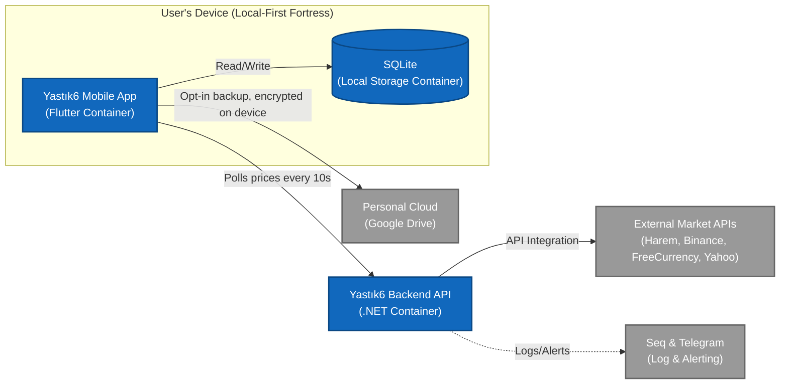

# Yastık6 – Architectural Blueprint
**Status:** Architectural Design & Systems Thinking Showcase

## 1. Executive Summary
Yastık6 ("yastık altı": savings kept under the pillow) is a privacy-first, local-first portfolio tracker for gold, currencies, stocks and crypto, built for Turkey. There are no user accounts: the portfolio lives in a SQLite database on the user's phone, and the backend never learns what anyone owns. The .NET backend is a **stateless BFF (Backend-For-Frontend) pipeline** that fetches six volatile market feeds, validates and normalizes them, and serves one identical price list to every client from memory. All profit/loss math runs on the device in exact decimal arithmetic.

I designed and built both sides on my own: a Flutter app and an ASP.NET Core (.NET 10) backend running in production with CI/CD, structured logging and Telegram alerting.

> **▶ Watch the 2.5-minute demo:** [Yastık6 – Portfolio tracker demo](https://youtu.be/JhnMPA0rF7U)
>
> The source repositories are private. I'm happy to walk through the code live or grant read access on request.

### By the numbers
| | |
|---|---|
| Production, 7-day window (Oct 2026) | **0** errors · **32,540** successful price fetches · **93** unauthorized requests blocked |
| Price history retention | **6.09M → 356k rows** (~94% smaller) after downsampling old data |
| Market data providers | **6** (Harem, Binance, FreeCurrency + Yahoo Forex / Crypto / BIST), 2 of them automatic fallbacks |
| Automated tests | **46** backend (xUnit) · **40** frontend (flutter_test) |

## 2. System Architecture (C4 Level 2)



### Key Architectural Boundaries:

* **The Client Fortress:** The app and its SQLite database work as one isolated unit with no accounts and no server-side copy of user data. The database relies on the operating system's app sandbox and device encryption; the app does not add its own database encryption.
* **Stateless BFF Gateway:** The .NET API is a normalized gateway to external market data and holds no user state. Clients identify themselves with a shared API key sent in a header (`X-Mobile-Client-Key`). The key is compiled into the app, so it filters out casual bots and scrapers rather than acting as real authentication; a per-IP sliding-window rate limiter sits in front of it.
* **Encrypted Backups:** Backups are opt-in. Before upload, the app encrypts the database with **AES-256-GCM** using a key derived from a passphrase the user chooses (PBKDF2-HMAC-SHA256, 210,000 iterations, random salt). The key is never stored, so neither Google nor I can read a backup, and it can be restored on a new phone with the same passphrase. Google Drive is the supported provider; iCloud is not wired up yet.

## 3. Engineering Philosophy & Constraints

**Privacy-by-Design over Centralized Convenience**
Yastık6 operates under a strict constraint: user financial data is a liability, not an asset. By rejecting the standard "user account + cloud database" model, the server simply has nothing to leak. The cost is that features normally solved server-side, like backups and multi-device restore, had to be solved on the device: here, passphrase-encrypted backups that the cloud only stores as opaque blobs.

**The Stateless BFF (Backend-For-Frontend) Trade-off**
Connecting a mobile app directly to several financial APIs makes it brittle: every vendor change or outage would ship to users as an app bug. The .NET 10 backend absorbs that volatility. It standardizes the feeds, retries and fails over between providers, and delivers one clean price list, while knowing nothing about who is asking.

**Deterministic Accuracy and the Single Source of Truth**
Portfolio and profit/loss figures must be exactly reproducible. The device is the single source of truth, and all money math uses the `decimal` package instead of floating point, so offline use and historical edits always produce the same totals.

## 4. Core Architectural Patterns

**Load Mitigation & Client-Server Contract**
Clients never trigger a fetch from an external API. Background workers poll the providers on their own schedule and keep the latest snapshot in memory; the market endpoint serves that snapshot without touching the database. UI interactions are therefore decoupled from upstream rate limits and from backend compute. (The design is meant to scale cheaply; it has not been load-tested yet.)

**Provider Strategy & Automatic Failover (Backend)**
Each data source (Harem, Binance, FreeCurrency, Yahoo Finance) sits behind a common provider interface with its own mapper, so a vendor changing its response format only touches that provider. When a primary provider keeps failing after its retries, traffic switches automatically to a backup and I get a Telegram alert. When the primary comes back, the system switches back and reports how long the outage lasted:

```csharp
string? fallbackProviderName = providerType.Name switch
{
    "FreeCurrencyClient" => "YahooForexClient",
    "BinanceClient" => "YahooCryptoClient",
    _ => null
};
```

**Immutable Domain Entities (Client-Side)**
Raw network data never reaches the UI or the local database directly. It is mapped into immutable domain entities first, and assets that fail to parse are dropped individually instead of failing the whole batch.

**Offline-First Market Data (Client-Side)**
Every successful price fetch is cached on the device (1,041 assets in the demo). When the network drops, the app keeps working from the cache: you can still record trades and see your portfolio, and a warning icon shows that prices may be stale.

---

<details>
<summary><b>▶ 5. Client-Side Architecture (Flutter)</b> <i>(Click to expand)</i></summary>

<br>

Because the backend is strictly stateless, the Flutter client must operate as its own self-contained engine. It handles data orchestration, explicit SQLite migrations and deterministic financial calculations without relying on cloud compute.

**Concurrent State Orchestration (Riverpod)**
The application uses Riverpod to separate business logic from the UI. The `_dbMasterProvider` runs parallel `Future.wait` queries against SQLite to load holdings, transaction history and realized profits together. This local state is combined with `livePriceProvider`, which polls the backend every 10 seconds, to produce a unified `PortfolioSnapshot` without blocking the main thread.

**Exact Decimal Arithmetic**
Floating-point arithmetic (`double`) introduces rounding errors that are unacceptable in financial tracking. All money values (cost basis, prices, profit/loss) use the `decimal` package. Divisions, such as percentages, are computed as rational numbers and rounded to 10 decimal places.

**Domain-to-UI Mappers**
The widget tree is kept "dumb." Domain entities (`AssetPosition`, `Transaction`) are never passed directly to UI components. A `UniversalPortfolioMapper` converts them into formatted `LotUiModel` and `PortfolioDonutModel` objects, which keeps components like the `UniversalAssetPickerSheet` modular and reusable across asset classes.

</details>

<details>
<summary><b>▶ 6. Design Decisions Log</b> <i>(Click to expand)</i></summary>

<br>

| Decision | Alternative Considered | Why I Chose This |
| :--- | :--- | :--- |
| **In-Memory Snapshot Endpoint** | Direct DB / API Fetching | **Cheap to serve:** The market endpoint makes zero database calls. Background workers keep an in-memory snapshot up to date, and every client request is served straight from RAM. |
| **Decimal Precision Math** | Standard `double` types | **Financial Accuracy:** Floating-point math introduces rounding errors. All money math on the client uses the `decimal` package. |
| **Raw SQL & Bulk Ops via EF Core** | Dapper / Standard EF Tracking | **Performance on millions of rows:** The price history table reached ~6 million rows. Reads use `.AsNoTracking()` and `SqlQueryRaw` bucketing queries; retention deletes run as bulk `ExecuteDeleteAsync()` calls in daily chunks instead of loading entities into memory. |
| **Explicit SQLite Migrations** | ORM Auto-Migrations | **Data Sovereignty:** Because user data lives only on the device, a failed local migration means lost data. Schema upgrades rebuild each table explicitly (`CREATE TABLE … new` → `INSERT … SELECT` → `DROP` → `RENAME`) inside sqflite's upgrade transaction. |
| **Passphrase-Derived Backup Key** | Random key in device secure storage | **Restorable anywhere:** A key that lives only on the device makes a backup useless on a new phone, which is exactly when you need it. Deriving the key from a passphrase keeps backups unreadable to the cloud provider and portable between devices. The trade-off: a forgotten passphrase means an unrecoverable backup. |

</details>

<details>
<summary><b>▶ 7. Hard Problems & System Challenges</b> <i>(Click to expand)</i></summary>

<br>

**1. Defending Against Upstream Data Corruption (The Price Shield)**
When aggregating external APIs, the system is vulnerable to upstream glitches and zero-price anomalies, and one bad price would wreck every user's profit/loss figures. The backend's `PriceShieldValidator` checks each incoming price: a zero or negative value, or a jump of more than 40% from the last known price, is rejected, the last valid price is kept, and a Telegram alert is sent (muted for an hour so it can't spam). The first version had a flaw: a *real* move of more than 40% was rejected forever, so the symbol froze until a restart. Production showed it, with the same flash-crash alert for one crypto symbol firing every hour. Now a single spike is still rejected, but once three consecutive readings agree on the new level, the shield accepts it and sends a "re-anchored" alert. On the client, `PortfolioValuator` adds a second layer: if a live price is missing or zero, it falls back to the last price stored on the device.

**2. The FIFO Sequence Paradox (Time-Travel Prevention)**
Yastık6 allows users to retroactively edit past transactions. However, if a user attempts to change the date of a 'Buy' transaction to a date *after* a linked 'Sell' transaction, it creates a sequence paradox that breaks the First-In-First-Out (FIFO) queue. The client-side `PortfolioService` solves this by dynamically calculating `barrierDates`. It scans all related transactions and mathematically locks the calendar UI, physically preventing the user from backdating an entry into an invalid state.

**3. Normalizing Multi-Source Volatility**
Every market API has its own payload format, rate limits and failure modes. The challenge was building one provider pipeline that standardizes these feeds into a single deterministic price list, feeding the in-memory cache without letting a third-party failure cascade to the app.

**4. Smoothing Volatile Chart Data**
Raw financial APIs often return jagged, highly volatile time-series data that renders poorly on mobile charts. The client's `ChartDataSmoother` drops zero-value anomalies from the historical `PricePoint` data and applies a moving average, computed in `decimal`, before the data reaches the chart.

**5. Observability Isn't Real Until You've Traced a Live Request Through It**
Wiring Seq and a correlation-ID enricher into the backend looked complete on paper — the header was present on every response, `IHttpContextAccessor` was registered, the enricher was configured. Yet a log line generated deep inside `PriceService`, mid real HTTP request, still had no `CorrelationId` property when actually inspected in Seq. Trusting "it's configured" over "I confirmed the property is there" is exactly the gap that turns observability into theater instead of a real diagnostic tool. The fix replaced the unverified third-party enricher with `LogContext.PushProperty("CorrelationId", ...)` wrapped around the whole request pipeline — guaranteed by Serilog's own ambient log-context propagation rather than a package's undocumented internals. The same pass also caught a second, unrelated bug in a Polly retry callback: an implicitly-typed 3-parameter lambda had silently bound to Polly's `(Exception, TimeSpan, Context)` overload instead of the intended `(..., int)` one, rendering `"attempt []"` in every retry log instead of a real attempt number — invisible until someone actually read the rendered output in Seq rather than trusting the code compiled correctly.

**6. The Fallback That Never Fired**
The provider failover existed in the code for weeks and had never once run. `BasePriceClient` caught every fetch failure and returned an empty list, so `PriceSnapshotRefresher` never saw an exception: the backup providers and the crash alerts were unreachable code. A regression test that simulated an outage caught it. The fix was for a provider that still fails after its retries to throw a `ProviderFetchException`. That exception wraps the cause, so an `HttpClient` timeout (which surfaces as a `TaskCanceledException`) is no longer mistaken for the app shutting down. Then I added the other half: when a crashed provider comes back, the system logs the downtime, switches traffic back and sends a "Provider Recovered" alert. The tests that now guard this:

```text
GetMarketOverviewAsync_Throws_ProviderFetchException_AfterRetriesExhausted
GetMarketOverviewAsync_Wraps_HttpTimeout_SoRefresherDoesNotMistakeItForShutdown
ProviderFailure_TriggersFallback_AndSendsTelegramAlert
PrimaryComingBack_SendsRecoveredAlert_Once_AndClearsOutageAlert
```

**7. A Feed That Looked Frozen While Its Prices Were Moving**
Gold prices from Harem occasionally froze in the app even though the backend was fetching every 30 minutes without errors. I ruled out the polling schedule, the Price Shield and the reverse proxy using the logs. Then I compared the live API response against the price history table in the production database, and the cause showed up: fresh prices paired with an old timestamp. The Harem mapper took its "as of" time from the vendor's own `last_update` field, which sometimes lags behind the vendor's actual price changes, so the app's freshness check treated new data as expired. Every other provider used our own fetch time. Switching Harem to the same rule fixed it. Along the way I found and fixed an unrelated client bug: the app never read the `isMarketOpen` flag from the API, which disabled its closed-market staleness guard.

**8. A Restore That Could Delete Your Portfolio**
An audit of the backup flow found that restore wrote the downloaded file over the live database *before* decrypting it. A wrong key or a corrupted download would have left the user with an unreadable database and no portfolio. The restore now downloads and decrypts into temporary files, uses AES-GCM's authentication to reject a wrong passphrase or a tampered file, checks that the result really is a SQLite database, and only then closes the connection and swaps the file in. Tests simulate an old phone, a new phone and a fake cloud, and verify that every failure path leaves the current portfolio byte-for-byte unchanged.

</details>

<details>
<summary><b>▶ 8. Operations & DevOps</b> <i>(Click to expand)</i></summary>

<br>

* **CI/CD:** On the backend, an Azure Pipelines run on a self-hosted agent executes the full test suite on every push to `main`. Only a green run deploys: the pipeline connects to the production server over SSH, pulls the code and rebuilds the Docker Compose stack. On the frontend, GitHub Actions runs `flutter test` on every push.
* **Containers:** A multi-stage Dockerfile on .NET 10. Docker Compose runs the API and Seq with persistent volumes and `restart: unless-stopped`; both listen only on localhost behind a reverse proxy, and Seq is reached privately.
* **Observability:** Structured Serilog logs with a correlation ID on every request go to Seq, which has a production health dashboard (errors, successful fetches, blocked requests, latency per provider).
* **Alerting:** Telegram alerts for provider crashes, fallbacks, recoveries, rejected prices and re-anchors, all de-duplicated with a one-hour mute. A nightly report summarizes the day's incidents, and a `/rapor` chat command produces one on demand.
* **Data retention:** A daily worker keeps the last 7 days of price history at full detail, downsamples 7–30 days to 2-hour buckets and older data to daily buckets. This shrank the table from 6.09M to 356k rows.
* **API hygiene:** Per-IP sliding-window rate limiting, a `/api/health` endpoint with a database check, ProblemDetails error responses and correctly configured forwarded headers behind the proxy.

</details>
